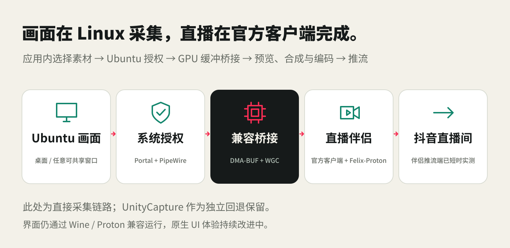

# Felix Live Compat


**在 Ubuntu 上，用熟悉的抖音直播伴侣做桌面与游戏直播。**

Felix Live Compat 为官方 Windows 客户端提供 Linux 兼容组件与安装工具：通过 Felix-Proton 运行客户端，把 Linux 的桌面、窗口采集接入伴侣自己的素材系统。项目已完成从零安装、采集预览、本地音画录制，以及隔离候选的短时开播测试。

**[下载预发行版](https://github.com/liyaomeng202114981-ops/Felix-Live-Compat/releases/tag/v0.1.0-rc.3.6)** · **[安装指南](docs/INSTALL.md)** · **[实测记录](docs/CLEAN_INSTALL_TEST.md)** · **[三张图了解项目](docs/SOCIAL_POST.md)**

## 现在能做什么

- **直接添加全屏和窗口素材**：在伴侣里发起选择，Ubuntu 弹出对应的系统共享框，授权后显示画面。这条 DMA-BUF／WGC 采集链路不经过虚拟摄像头，无需采集卡。
- **按需要选择多个窗口**：支持真实窗口标题、静止画面的首帧、后台更新，以及取消、删除和关窗后的资源清理。
- **使用官方媒体功能**：已验证本地视频录制与声音，早期隔离候选已完成全屏和窗口的短时实播。
- **融入 GNOME 桌面**：独立 Dock 入口、原客户端图标、单托盘，以及仅关闭本套安装的强制退出；修正了多项弹窗、透明辅助窗和最大化操作问题。
- **方便安装和维护**：提供依赖预检、从零安装及已有安装的原地更新工具，保留 UnityCapture 采集回退。

## 已通过哪些测试

以下是**分阶段实测结果**，详细证据和每个版本的复测范围均保留在仓库中。

| 项目 | 已验证结果 |
| --- | --- |
| 从零安装与重开 | 使用官方 x64 安装器，在独立空前缀安装、登录并从桌面入口重开 |
| 全屏采集 | 应用内触发系统授权，收到 **1920×1080 动态桌面** |
| 窗口采集 | 动态画面与帧号、多窗口、静止首帧、后台更新及清理行为 |
| 本地音画 | 录像解码验证 **720p30 视频 + 48 kHz 双声道 AAC**，恢复完整 8 秒测试音 |
| 短时开播 | 隔离候选完成**全屏约 33 秒、窗口约 28 秒**的伴侣推流端检查 |

实测环境：**Ubuntu 26.04 x86-64 · GNOME Wayland／XWayland · PipeWire · Vulkan · NVIDIA RTX 4060**；适配官方客户端 **13.3.5.564315535**。[版本表](compatibility.json) · [安装与录制验收](docs/CLEAN_INSTALL_TEST.md) · [短时推流记录](docs/SHORT_LIVE_TEST.md)

当前仍为**预发行兼容方案**。观众端画质、长时推流及其他软硬件组合待验证；UI 缩放流畅度仍在改进。`rc.3.6` 主要增加原地更新，未重跑整套媒体验收，音画与开播结果来自上述历史阶段。[本版范围](docs/releases/0.1.0-rc.3.6.md)

## 怎么实现



**Linux 负责采集，兼容层负责衔接，官方客户端负责直播。** 系统授权后，PipeWire 交付画面；DMA-BUF 与 WGC 兼容组件把它接入伴侣的 Windows 图形捕获接口，继续由客户端预览、合成、编码并推流。Wine IPC 等配套修正让媒体服务和客户端能够正常通信。[采集实现与源码](src/wgc-compat/README.md)

客户端界面目前通过 Wine／Proton 兼容运行。原生 Wine Wayland 和 Linux 界面解耦属于研究方向，尚未作为已通过验收的完整 UI 功能发布。

## 安装与更新

1. 下载 [兼容包](https://github.com/liyaomeng202114981-ops/Felix-Live-Compat/releases/tag/v0.1.0-rc.3.6)，从[官方渠道](https://streamingtool.douyin.com/)获取 Windows x64 安装器。
2. 按[安装指南](docs/INSTALL.md)做依赖预检，首次安装选择新的空目录。安装工具会下载并校验固定运行器，本包不是完整离线安装器。
3. 启动后扫码登录，在伴侣中添加全屏或窗口素材，完成 Ubuntu 系统授权。

已有兼容版可在退出伴侣后使用原地更新，保留运行器、客户端与前缀：

```bash
python3 -B tools/felix_live.py patch --root ~/Games/Felix-Live-Compat
```

[更新前提与回退](docs/PATCH_INSTALL.md) · [版本变更](docs/releases/0.1.0-rc.3.6.md) · [详细兼容修正](docs/COMPATIBILITY_DETAILS.md)

## 开源与后续工作

由 **Felix Li** 维护，基于 Wine、Proton、DXVK，以及 SHORiN-KiWATA 的 WE-Proton／shorin-proton-wrapper，保留各自作者、来源和许可证。本仓库公开兼容层、补丁、安装工具与验收资料；官方客户端、安装器和账号数据不随包分发。[来源与许可](THIRD_PARTY.md) · [Felix-Proton](https://github.com/liyaomeng202114981-ops/Felix-Proton)

后续重点是进一步改善 UI 缩放与呈现体验，并按官方 Windows 客户端构建号维护兼容版本；新版本通过隔离验收后再发布。[UI 研究](docs/UI_RESIZE_ASSESSMENT.md) · [路线讨论](docs/FEASIBILITY_DISCUSSION.md)
