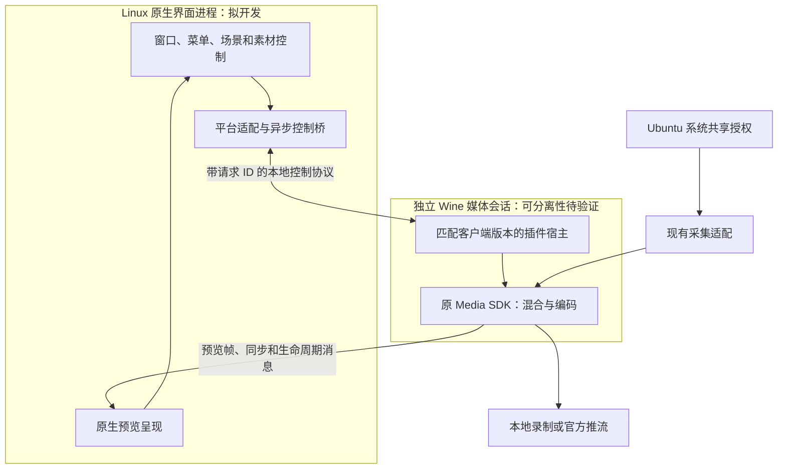

# 路线一：Linux 界面＋Wine 媒体后端

状态：已有独立控制及快照原型，完整界面和连续预览未实现。2026-11-20 用户先授权规划，随后授权低成本尝试并继续定位初始化崩溃；不表示批准迁移日常安装。RC3.4 发行保持 Windows 运行时和原媒体配置。

本地开发原型已能从 Linux 界面启动独立 Wine 宿主，按已安装客户端的原产品配置初始化官方媒体 SDK，读取 `13.3.5.7`，并让 SDK 渲染、切换自有 320×180 测试场景后返回两张快照。初始 metasecml.dll 退出通过补齐原产品上下文解决，没有提供账号／设备标识或修改检查。本结果缩小了后端可分离性的不确定性，但不等于 P2 全部能力或 P3 的持续 GPU 预览已通过。[代码、复跑与边界](../experiments/wine-sdk-bridge/README.md)

## 要解决的问题

让窗口缩放、最大化、拖动、菜单和托盘更多地由 Linux 运行时处理，同时尽可能保留已跑通的媒体采集、混合、编码及官方业务。现有默认配置的主要缩放阻塞在输出表面重建与同步等待，未发现布局计算占据主要耗时。[当前测量](UI_RESIZE_ASSESSMENT.md)

当前伴侣不是可直接换壳的纯网页。本机 `13.3.5.564315535` 有 14 个 `.node`，抽查 12 个为 Windows PE，包含 MediaSDK、PipeSDK、快捷键和可见性等插件。Linux Electron 不能直接装载它们；私有引擎扩展也可能无法由标准 Electron 替代。目前仅证明独立 SDK 初始化和自有场景快照，尚未覆盖完整媒体业务与前端。[Electron 进程模型](https://www.electronjs.org/docs/latest/tutorial/process-model) · [原生模块的平台和 ABI 要求](https://www.electronjs.org/docs/latest/tutorial/using-native-node-modules)

## 目标结构展示

控制消息与视频数据分开：按钮通过异步消息控制后端，预览使用单独的帧通道，缩放 Linux 窗口不应同步等待媒体后端调整大小。理想情况下仅更新原生预览视口，录制／推流分辨率和原始帧节奏保持稳定；这一点仍需通过实际计时与图像验证。

Linux 进程不能直接使用 Windows D3D11 纹理句柄。预览首轮允许有明确标记的 CPU 拷贝作正确性诊断；若要获得预期性能，需要继续验证 DXVK／Vulkan 与 Linux DMA-BUF 的格式、modifier、同步及对象生存期，不能把现有采集方向的 DMA-BUF 成功直接当作反向预览已经可用。CPU 拷贝版本即使出画面，也不算零拷贝或低负载目标通过。

## 分阶段实施与交付

| 阶段 | 工作与交付物 | 进入下一阶段的证据 |
| --- | --- | --- |
| P0：依赖地图 | 固定客户端与引擎版本；列出主进程、preload、渲染器和本地插件调用；区分官方业务、平台功能和媒体功能 | 找到可保持业务行为的桥接边界，明确哪些接口必须替代及哪些只有私有二进制 |
| P1：自有桥接样机 | 自有 Linux Electron 测试 UI＋自有 Wine 测试后端；本地私有套接字发送帧号、尺寸及测试图像；不接真实账号 | 原生窗口缩放时测试画面持续更新；请求取消、后端退出及恢复有界；能独立清理，不注册新 Dock 入口 |
| P2：官方媒体后端可分离性 | 在独立前缀中使用匹配版本的 Windows 插件宿主，验证能否承接媒体控制与预览 | 原 SDK 在没有原主界面依赖的情况下正确工作，或证明最小受控宿主可行；缺必要私有接口时明确停止该路线推进 |
| P3：桥接与预览优化 | 逐项替代 Linux 不可用的原生插件功能，接通场景、素材和预览；优先验证 GPU 帧传递 | 同帧号／尺寸／格式及同步正确；记录复制次数、GPU readback、CPU／GPU 和延迟；不靠无限等待、阻塞 UI 或复制纹理掩盖问题 |
| P4：原界面与系统交互 | 在依赖条件允许时接入原前端；适配窗口控制、托盘、快捷键、系统共享框、关闭确认及更新流程 | 用户可按原有操作完成全屏／窗口授权与预览；多素材、取消、删除、后台、关闭清理行为正确 |
| P5：独立验收 | 与 RC3.4 相同环境、相同素材做 UI、全屏／窗口及本地音画录制对照 | 各项边界通过后再讨论安装包；短时实播及观众端验证需要另行授权 |

P1 仅证明自有桥能工作，不证明官方客户端已经移植。P2 是决定性关口：原生插件可能依赖特定 Electron 导出、进程上下文及私有协议，不能简单在普通 Wine EXE 中 LoadLibrary 后就认定可用。未通过时保留 RC3.4 与现有独立 UI 后端优化方向，不以“重新实现全部客户端”扩大本轮范围。

## 预期操作效果展示

以下均为目标流程，尚未实测：

| 用户操作 | 拟实现的表现 | 后端应保持的行为 |
| --- | --- | --- |
| 点击原应用入口 | 一个正常的 Linux 主窗口和一个托盘图标 | 启动匹配的独立媒体会话，无可见控制台或测试辅助窗 |
| 拖动窗口边缘、最大化和下拖 | 由 Linux 运行时处理窗口；预览视口随窗口变化，UI 不同步等待媒体输出重建 | 已有素材持续更新，录制尺寸及音频时间轴不因 UI 缩放改变 |
| 添加「全屏」 | 弹出 Ubuntu 显示器共享框，授权后直接显示预览 | 已有显示器采集与用户选择对应 |
| 添加「窗口」 | 弹出 Ubuntu 窗口共享框，使用选中窗口的标题，支持再次选择其他窗口 | 独立素材保持自己的共享会话、帧流和清理关系 |
| 取消共享或删除素材 | 取消不会留下占位素材；删除后释放该路帧流 | 不影响其他素材和声音 |
| 普通退出／强制退出 | 正常退出保留业务确认；强退只结束这套兼容会话，图标随退出消失 | 有限时间回收帧、套接字和子进程，日常安装不受影响 |

## 测量和目标

不承诺“与 macOS 完全一样”“零开销”或“所有路径零拷贝”。采用可复核目标：

- 使用固定尺寸序列、相同预热和场景，对比 RC3.4 与原生样机；分别记录窗口几何到达、前端布局／绘制、提交、预览帧到达和呈现。原生窗口的代理标记须与 Wine 对照定义一致。
- 第一轮性能目标为重复试验中缩放代理 p95 低于 RC3.4、超过 100ms 的停顿比例下降；绝对数值待 P1 建立基线后确定。以 60 Hz 为体验目标时每次刷新约 16.7ms，不能将当前 239.66 Hz 屏幕的结果混成 60 Hz 基准。
- 区分空闲、10 Hz 和 40 Hz 缩放条件，记录总进程组 CPU、GPU 可用计数、内存和预览新帧。不能因一组平均 CPU 降低就声称所有负载改善。
- 自有测试窗覆盖变色帧号、缩放、遮挡、最小化、还原和关闭；重复添加两路、取消与删除后没有孤儿会话。恢复后的动态帧必须继续更新。
- 通过本地录制的闪光／测试音时间标记与帧号，检查音画偏移、持续漂移和输出分辨率；与 RC3.4 同样参数比较。UI 流畅不替代媒体质量验收。
- 实际记录跨进程帧通道有无 CPU 拷贝。只有实际链路和计时支持时才使用“GPU 零拷贝”描述；DMA-BUF 名称本身不构成证明。

## 隔离、回退与跟版

原型只在私有独立目录、独立运行器和前缀进行，不热改日常二进制，不改系统声音、直连、DNS、VPN 或 GNOME 配置。初期只用自有测试 UI／画面，不开播。用户现有全屏／窗口与 UnityCapture 回退继续保留，先不更换原 Dock。

本地协议需要有版本号、能力查询、请求 ID、取消和退出通知；套接字放在 0700 的运行目录并校验本地对端身份。优先继承服务组管理，不提供任意进程调用入口。截图、账号、Cookie、令牌和官方私有资源不进入公开源码与示意材料。

后续 Windows 客户端更新可能改变插件 ABI、IPC 和前端调用。每个兼容组合须固定版本与能力清单，未匹配时拒绝迁移，回到已验证的 Windows UI 路径。停止原型并继续使用 RC3.4 即是第一阶段回退方式；完成独立验收前不写入日常配置，也不自动升级入口。

## 当前交接状态

用户因额度紧张暂缓进一步开发，保存为 0.2.0-experimental.1 实验源码快照。日常 RC3.4 不切换、不自动继续任务。完整核心需求的复杂度和恢复顺序见[讨论记录](FEASIBILITY_DISCUSSION.md)。
